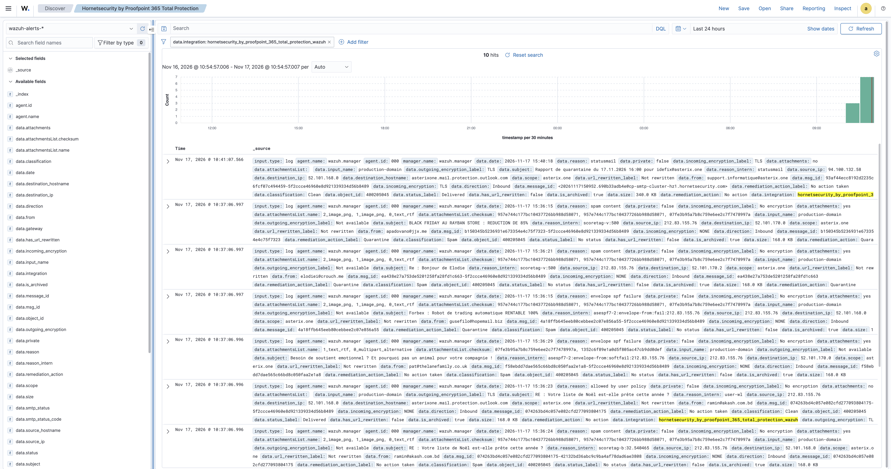
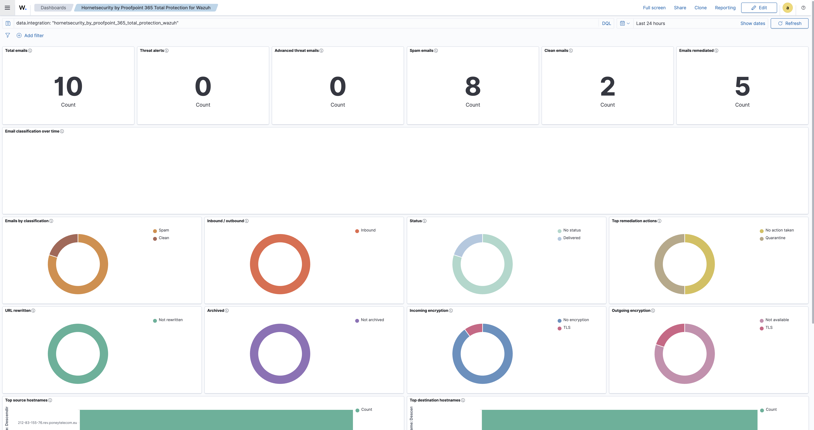

# Hornetsecurity by Proofpoint 365 Total Protection for Wazuh

Collects email security events from Hornetsecurity by Proofpoint 365 Total Protection and writes them as JSON lines for Wazuh Logcollector. The included rules create alerts for detected threats, remediation actions, and spam classifications.

> **Status:** Version 1.0.0. This integration has been installed locally with Wazuh Manager 4.14.9. It uses Python 3.10 or newer and the Hornetsecurity by Proofpoint Control Panel API v0. Other Wazuh, Python, and API versions have not been compatibility-tested. Validate it in a non-production environment before wider deployment.

## Requirements

- Wazuh Manager with Python 3.10 or newer available in the manager environment.
- Network access from the manager to the API endpoint `https://cp.hornetsecurity.com` or `https://cp.proofpoint.com`.
- An API token created in either of the Control Panel URLs listed below, with permission to read email security data.
- Permission to install a script, configuration, and custom rules on the manager.

The collector writes `data.integration` as `hornetsecurity_by_proofpoint_365_total_protection_wazuh`. The collector uses Python's standard library only; it does not require third-party Python packages.

## Configure the integration

### 1. Create the API token

The Control Panel is available at [cp.hornetsecurity.com](https://cp.hornetsecurity.com) and [cp.proofpoint.com](https://cp.proofpoint.com). 

Create the token in either portal:

1. Open either Control Panel URL and sign in.
2. Open the menu in the top-right corner and select **User settings**.
3. On the User settings page, open the **API Token** tab.
4. Click **Create token**, enter a name for the token, then click **Create**.
5. Copy the token from the **Token details** section and store it securely.
6. The API Token tab lists your tokens, expiration dates, and other details.

Use an account authorized to read the relevant email events. Do not commit the token or paste it into issue reports or logs.

### 2. Create the input configuration

Copy `config/inputs.example.json` to the manager as `/var/ossec/etc/hornetsecurity/inputs.json`, then edit it:

```json
{
  "inputs": [
    {
      "name": "production-domain",
      "enabled": true,
      "scope": "example.com",
      "direction": "inbound_outbound"
    }
  ]
}
```

Replace `example.com` with the object name from your Hornetsecurity by Proofpoint 365 Total Protection tenant. `direction` accepts `inbound_outbound`, `inbound`, or `outbound`. On its first run without a checkpoint, the collector looks back two hours. Multiple inputs can be listed; each enabled input needs a unique name.

### 3. Provide the API token

The collector supports either of these methods:

- **Environment variable:** set `HORNETSECURITY_API_KEY` in the manager's service/container environment. `.env.example` shows an example environment configuration. Keep the real `.env` file out of Git and restrict its permissions (for example, `chmod 600 .env`). Be aware that environment variables may be visible to administrators and container-management tooling.
- **Secret file (recommended where practical):** mount the token in a file readable only by the manager service, then set `HORNETSECURITY_API_KEY_FILE` to that path. For example, store the token in `/run/secrets/hornetsecurity_api_key` with restrictive ownership and permissions. Do not put the token in `inputs.json`.

The token is sent to the API in the HTTPS `Authorization` header. The collector does not intentionally log the token or request headers.

## Install on a Wazuh Manager

Install these files into the manager environment (container or host) and adapt the paths for your deployment:

1. Copy `scripts/hornetsecurity_collector.py` and `scripts/VERSION` to `/var/ossec/integrations/`. Make the script executable and readable by the Wazuh manager process.
2. Create `/var/ossec/etc/hornetsecurity/` and place the configured `inputs.json` there. Restrict access to the file.
3. Copy `rules/hornetsecurity_rules.xml` to the manager's rules directory, commonly `/var/ossec/etc/rules/`.
4. Merge the contents of `config/ossec_hornetsecurity.conf` into the existing `/var/ossec/etc/ossec.conf` `<ossec_config>` element. Do not replace the existing manager configuration with this snippet. The `<localfile>` entry reads `/var/ossec/logs/hornetsecurity/events-*.json`; the command wodle runs the collector once per minute and on manager start.
5. Configure the API token environment variable or secret-file variable for the manager process. Set `HORNETSECURITY_CONFIG` or `HORNETSECURITY_CHECKPOINT_DIR` only if using paths other than the defaults documented below.
6. Validate the files and configuration, then restart the Wazuh Manager using the method appropriate for your installation.

For a Docker Compose setup, bind-mount the script, `VERSION`, rules, and input configuration into the manager container at the paths above; provide the secret to that container without baking it into an image. Recreate the manager container after changing mount definitions. A restart alone does not apply changed mounts.

## Verify

Run these commands in the manager environment:

```sh
python3 /var/ossec/integrations/hornetsecurity_collector.py --version
python3 /var/ossec/integrations/hornetsecurity_collector.py --check-config
```

Check the manager logs for messages prefixed `hornetsecurity-collector:` and confirm that events appear in Wazuh. The collector emits JSON event lines to stdout and appends them to daily files under `/var/ossec/logs/hornetsecurity/` by default. The configured Wazuh `<localfile>` entry monitors those files.

## Custom rules and rule ID collisions

The included rules use IDs `100500`–`100503`. Wazuh rule IDs must be unique across the manager. Check your existing local and vendor rules before installation. If these IDs are already in use, choose four unused IDs and update the IDs and corresponding `<if_sid>` references in `rules/hornetsecurity_rules.xml` before copying it. Keep the first event rule as the parent of the three specific detection rules.

The rules detect the event integration marker and classify threat, remediation, and spam events. The threat rule recognizes `Threat`, `Advthreat`, and common explicit threat labels such as malware, phishing, virus, ransomware, trojan, and spyware. Tune levels, conditions, and descriptions to match your environment and the values returned by Hornetsecurity by Proofpoint 365 Total Protection.

## Import the Wazuh dashboard

After the integration is installed and Wazuh has indexed at least one event from Hornetsecurity by Proofpoint 365 Total Protection, import [`dashboard/hornetsecurity-wazuh.ndjson`](dashboard/hornetsecurity-wazuh.ndjson):

1. Open the Wazuh Dashboard.
2. Go to **☰ → Dashboard management → Saved objects**.
3. Select **Import**, choose `hornetsecurity-wazuh.ndjson`, and confirm the import. If updating an existing dashboard, enable **Overwrite existing objects**.
4. Open **Dashboards** and select **Hornetsecurity by Proofpoint 365 Total Protection for Wazuh**.

The dashboard includes 19 panels.

## Update or uninstall

To update, back up the current script, rules, input configuration, and checkpoints; replace the script, `VERSION`, and rules with the new release; review the changelog; validate the input configuration; then restart/recreate the manager as required by your deployment. Preserve the input configuration and checkpoint directory unless you intentionally want a fresh lookback and possible duplicate events.

To uninstall, remove the integration's `<localfile>` and `<wodle>` entries from `ossec.conf`, remove its custom rules and installed files, and restart the manager. Remove local event logs and checkpoints only if your retention policy permits. This does not remove alerts already indexed in Wazuh.

## Troubleshooting

- **`HORNETSECURITY_API_KEY is required`:** configure `HORNETSECURITY_API_KEY` or `HORNETSECURITY_API_KEY_FILE` in the manager process environment.
- **Invalid configuration:** run `--check-config`; confirm valid JSON, a non-empty `inputs` list, supported direction, and unique enabled names.
- **HTTP 401/403:** check token validity and read permissions in the Hornetsecurity Control Panel.
- **Object cannot be resolved:** check the scope name spelling or use its numeric object ID, and confirm the token can access it.
- **No alerts:** inspect manager logs, verify the `<wodle>` is enabled and `python3` is available, confirm the output path and `<localfile>` location match, check rule loading and ID uniqueness, and confirm the API query window contains events.
- **Container mount errors:** verify each host source exists and that file mounts point to files (script, `VERSION`, rules, inputs), not directories. Recreate the manager container after changing Compose mounts.

## Screenshots

**Discover:** Events from the Hornetsecurity by Proofpoint 365 Total Protection for Wazuh integration in Discover.



**Dashboard:** Overview of events and classifications from the Hornetsecurity by Proofpoint 365 Total Protection for Wazuh integration.


## License

Unless expressly stated otherwise, all software, source code, scripts, documentation, and other materials made available in this repository are proprietary to Hornetsecurity and are governed by the Hornetsecurity GitHub Content License Agreement.

By downloading, installing, accessing, or using any materials from this repository, you agree to be bound by the terms of that Agreement [LICENSE.md](LICENSE.md).

The [SECURITY.md](SECURITY.md) file explains how to report vulnerabilities.

Where any repository, file, or component is expressly subject to a separate license, including an open-source license, such separate license shall exclusively govern the relevant materials.